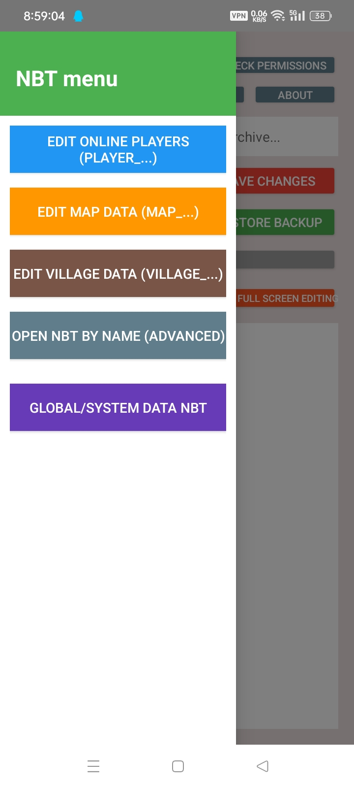
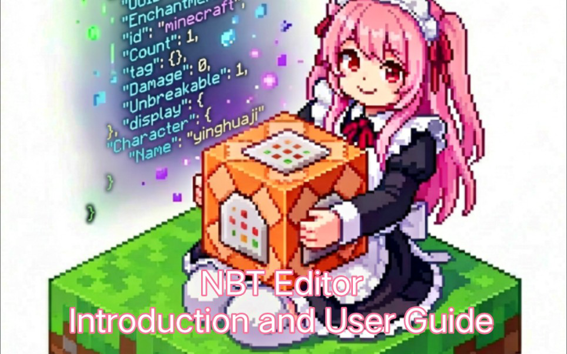

<h1 align="center">Nibnya</h1>

<!-- SHIELD GROUP -->
[![Version][version-shield]][version-link]
[![License][license-shield]][license-link]
[![Issues][issues-shield]][issues-link]

[![Forks][forks-shield]][forks-link]
[![Stars][stars-shield]][stars-link]
[![Contributors][contributors-shield]][contributors-link]

<!-- 社交与外部链接 -->
[![Bilibili][bilibili-shield]][bilibili-link]
[![QQ Group][qq-shield]][qq-link]
[![Telegram][tg-shield]][tg-link]

English · [Chinese](./README.zh-CN.md) · [Change log](./CHANGELOG.md)

 

> [!TIP]
> It's finally halfway stabilized, and there's still some stuff that will be added later on

> [!WARNING]
> I know there will be problems, but I still have to apologize 
> **This application code is written by deepseek v4** 

> [!TIP]
> Do you want to participate in this, add application functions, modify functions, etc. 
> Please fork and submit a PR, or patch and tidy it up yourself after forking.

<kbd>Table of contents</kbd>

#### directory listing

- [🌸 Project Introduction](#-Project-Introduction)
- [🖼️ App Screenshot](#-App-Screenshot)
- [🚀 Get started quickly](#-Get-started-quickly)
- [📄 Update Log](#-Update-Log)
- [👥 Thank you list](#-Thank-you-list)
- [📜 Open source agreement](#-Open-source-agreement)

 

## 🌸 Project introduction
The imitation Blocktopograph is not directly adapted from him.
Just like a tire, a similar

## 🖼️ App screenshots

<kbd>🌸 View app interface preview</kbd>

   
  <!-- 这里直接引用底部的链接名是不行的，必须写路径或者直接用引用式 -->
  <!-- 建议如果需要限宽，直接在 details 里用 img 标签 -->
  
   
  
   
  
   
  
   
  
   
  
   
  
   
  
   
  
   
  
   
  
   
  
   
  
   
  
   
  
   
  
   

## 🚀 Get started quickly
### 📺 Introduction to use

Introduction and usage tutorial：

> [!TIP]
> Make sure you **have the basics[Shizuku](https://github.com/RikkaApps/Shizuku)use**, the app will ask for 
> Otherwise, you will be **unable to access Android/data** Minecraft files. 
> **Currently only supports Android 9 ~ 13** 
> Obtaining all file permissions is for the download directory to read and write to the old directory and the private directory.

## 📄 Change log

<kbd>This release (1.0.4 stable)</kbd>

#### Added

- [x] **ROOT support**: a unified privilege layer with three modes — ROOT / Shizuku / Normal. Root detection does not check whether a `su` binary exists; it actually runs `su -c id` and looks for `uid=0`, so "su installed but not granted" and fake root are never misdetected.
- [x] **Execution mode selector**: a new "Execution mode" row in Settings that expands in place (no pop-up): Auto / ROOT / Shizuku / Normal. Choosing ROOT on a device without root falls back to Shizuku, then to Normal, with a toast telling you what actually took effect.
- [x] **Custom su command template**: you can change the `su -c {cmd}` form to match Magisk / KernelSU / modified su. Three presets are included (`su -c`, `su -0 -c`, `su --mount-master -c`); tapping one runs a real test immediately and tells you whether it works. A template must contain `{cmd}` to be saved.
- [x] **"App internal" path**: the path picker now offers `/data/user/0/<package>/games/com.mojang/minecraftWorlds/` — Minecraft's actual private directory. It is **only shown when real root is available**, and re-tested every time the picker opens.
- [x] **Write-back now uses atomic replacement**: new data is fully staged in a temp directory on the same partition, the original is renamed aside, the new one takes its place, and only then is the old copy removed; any failure rolls back immediately. A self-check (`CURRENT` must exist, no nested folders) rolls back automatically on anomalies.
- [x] **World thumbnails actually appear**: the standard path lives under `Android/data`, where Android 11+ scoped storage makes direct reads fail, so the three tiles used to stay grey forever. Bytes are now streamed through the privilege channel and decoded in memory, never touching disk.
- [x] **Three-line world list layout**: world name / folder ID / last played are separate rows now, so a long name can no longer squeeze out the timestamp; the folder ID elides in the middle so the trailing `=` stays visible.
- [x] **Edge-swipe sidebar**: swipe right within 18dp of the left edge to open; when open, swipe left anywhere to close. The scrim is fully transparent but still handles tap-to-close.
- [x] **Dark mode properly supported**: two palettes (light / dark) were added and all 76 hard-coded colours in layouts and code now use theme colours; system dialogs (settings / backups / restore / root-node actions, etc.) follow along instead of staying white and unreadable.
- [x] **Permission check moved into Settings**: the home header is now just "Clear cache / Switch path"; the permission check lives in Settings and runs a real test on tap, with a clear verdict.
- [x] **Seed copies on a single tap**: no more long-press-and-select, and the emoji is no longer copied along with the number.
- [x] **Free-crop now honours the row/column count**: previously choosing 5×5 and then switching to "Free crop" produced only 1 map; it now splits into the full 25.
- [x] **Square lock adjusts automatically**: turning on "Lock ratio (square)" immediately snaps the crop box to the largest square, instead of waiting for you to drag it.

#### Fixed

- [x] **Saves written under root were unreadable by the game** (most serious): files written as root are owned by `root:root`, while Minecraft runs as its own uid with `rw-------` permissions — so the files were there and the size looked fine, yet the game reported "Unable to connect to world" and the list showed an absurd `4167549952`. Ownership is now handed back to the owning app before the write completes.
- [x] **Ownership repair looped on itself**: the old logic preferred the ownership of the *current* db directory, so once it had been corrupted to root it stayed root and every save corrupted it again. The authoritative source is now the app's own directory.
- [x] **su command was split by the outer shell**: when the command contained `&&`, only the first part ran as root while the rest ran as the ordinary app uid, so `cp` failed with `Permission denied` — it looked like "root can't write". The whole command is now passed as a single argument.
- [x] **Deleting an "app internal" world failed under root**: `/data/...` is only visible to root, so the native existence check always returned false and the app claimed the world folder was missing.
- [x] **Automatic repair for already-broken saves**: ownership is checked when a world is opened, so save files corrupted by earlier builds can be rescued without re-saving.
- [x] **Android 16 / HyperOS only said "cannot write"**: it now probes real writability and gives an actionable fix (HyperOS requires enabling "USB debugging (Security settings)" separately).
- [x] **Three sidebar interaction bugs**: swiping stopped working after closing, the scrim was unclickable (taps fell through to the main screen), and there was no right-to-left close gesture.
- [x] **First swipe only showed the scrim / wrong width**: the width read as 0 right after the view became visible, so positions were computed incorrectly.

<kbd>Resolved</kbd>

- [x] Recycle bin: deleting a world moves it there first, so nothing is unrecoverable
- [x] Export `.mcworld`: pack a whole world into a file Minecraft can import directly
- [x] Draft box: unsaved edits are kept in a draft box instead of interrupting with a pop-up
- [x] Clipboard rework: copies also go to the system clipboard, in JSON / SNBT / plain text
- [x] Export to file: to the Download folder, or to any folder you pick via SAF
- [x] **Full SAF support**: read / write / delete all go through DocumentFile, and saving is no longer "falsely reported as successful"
- [x] Unified world picker / draft box / backup lists, with a bottom tab bar and long-press menus
- [x] **Fixed: player data lost after adding a List** — the root cause was deleting LevelDB index files
- [x] Fixed: large worlds misdetected as LOCK and refusing to open
- [x] Fixed: the tree view is now fully usable (add / edit / delete / search / save)
- [x] Fixed: out-of-memory when generating map art
- [x] Fixed: two inconsistent backup directory definitions ("clear backups" cleared an empty folder while reporting success)
- [x] Fixed: opening Settings popped up the "custom" input box, and the panel could not scroll
- [x] Fixed: crash when entering a custom draft interval / thread count
- [x] Fixed: the session-restore dialog showed the wrong target; a discarded session no longer comes back
- [x] Fixed: the tab bar would not stick to the bottom
- [x] Fixed: issue #6 — saving to a custom path no longer falsely claims "Shizuku is required"
- [x] Multi-threading settings actually take effect (file copy + map art, with tunable concurrency)
- [x] Complete internationalization (EN / ZH string keys match exactly)
- [x] Code reorganised by domain (`nbt/` `db/` `editor/` `world/` `mapart/` `util/`)
- [x] Renamed to Nibnya / 樱喵NBT, new icon, and the data folder `NbtEditor_Data/` → `Nibnya/`

<kbd>To do</kbd>

- [ ] Low memory on large worlds (the app can be killed by the system)
- [ ] Auto-update
- [ ] UI polish
- [ ] Backup policy (stop backing up on every save; time-based / opt-in / manual)
- [ ] Map plane view and editing (view / modify / move chunks)
- [ ] Multiple worlds open at once (the same world must not be opened twice)
- [ ] Blocktopograph-style theme
- [ ] Preset templates (player / village / map)
- [ ] One-click tools (32767 equipment, command-line items, …)
- [ ] A third page with handy Bedrock utilities
- [ ] Upgrading old worlds across major versions
- [ ] Multi-user support
- [ ] KMP cross-platform (Windows / Linux desktop)

_Other ideas and modifications are still being implemented_

## 👥 Thank you list
 [@Yejdhi](https://github.com/Yejdhi) Provided me with many methods and modification ideas 
 [@LeviMC](https://github.com/LiteLDev) Provided me with methods and ideas for modifications 
(It is also recommended to take a look at LeviMC’s open source projects)

## 📜 Open source agreement

This project uses **[AGPL 3.0](https://www.gnu.org/licenses/agpl-3.0)** protocol

<!-- 这里是底部的链接定义-->

[version-shield]: https://img.shields.io/badge/Version-v1.0.4a-369eff?style=flat-square&labelColor=black
[version-link]: https://github.com/yinghuajimew/Nibnya/releases

[issues-shield]: https://img.shields.io/github/issues/yinghuajimew/Nibnya?color=ff80eb&labelColor=black&style=flat-square
[issues-link]: https://github.com/yinghuajimew/Nibnya/issues

[forks-shield]: https://img.shields.io/github/forks/yinghuajimew/Nibnya?color=8ae8ff&labelColor=black&style=flat-square
[forks-link]: https://github.com/yinghuajimew/Nibnya/network/members

[stars-shield]: https://img.shields.io/github/stars/yinghuajimew/Nibnya?color=ffcb47&labelColor=black&style=flat-square
[stars-link]: https://github.com/yinghuajimew/Nibnya/stargazers

[contributors-shield]: https://img.shields.io/github/contributors/yinghuajimew/Nibnya?color=c4f042&labelColor=black&style=flat-square
[contributors-link]: https://github.com/yinghuajimew/Nibnya/graphs/contributors

[license-shield]: https://img.shields.io/badge/license-AGPL_3.0-blue?style=flat-square&labelColor=black
[license-link]: https://www.gnu.org/licenses/agpl-3.0

<!-- 社交链接定义 -->

<!-- Bilibili: 少女粉 #FB7299 -->
[bilibili-shield]: https://img.shields.io/badge/Bilibili-FB7299?style=flat-square&labelColor=black&logo=bilibili&logoColor=white
[bilibili-link]: https://www.bilibili.com/video/BV16dfnBrEzT

<!-- QQ交流群: 腾讯蓝 #12B7F5 -->
[qq-shield]: https://img.shields.io/badge/QQ_group-12B7F5?style=flat-square&labelColor=black&logo=qq&logoColor=white
[qq-link]: https://qm.qq.com/cgi-bin/qm/qr?_wv=1027&group_code=1077349003

<!-- Telegram频道: 电报蓝 #26A5E4 -->
[tg-shield]: https://img.shields.io/badge/Telegram-26A5E4?style=flat-square&labelColor=black&logo=telegram&logoColor=white
[tg-link]: https://t.me/yhjmew_minecraft_nbteditor