

<h1 align="center">樱喵NBT</h1>

<!-- SHIELD GROUP -->
[![Version][version-shield]][version-link]
[![License][license-shield]][license-link]
[![Issues][issues-shield]][issues-link]

[![Forks][forks-shield]][forks-link]
[![Stars][stars-shield]][stars-link]
[![Contributors][contributors-shield]][contributors-link]

<!-- 社交与外部链接 -->
[![Bilibili][bilibili-shield]][bilibili-link]
[![QQ Group][qq-shield]][qq-link]
[![Telegram][tg-shield]][tg-link]

[English](./README.md) · 中文 · [变更日志](./CHANGELOG.zh-CN.md)

 

> [!TIP]
> 目前总算稳定一半了，还有一些东西后续会补下去

> [!WARNING]
> 我知道会有问题，但是我还得道歉 
> **此应用代码由 deepseek v4 编写** 

> [!TIP]
> 您想要参与到此，应用功能添加，功能修改等 
> 请fork并提交pr，或者fork后自己修补并整理

<kbd>目录</kbd>

#### 目录列表

- [🌸 项目简介](#-项目简介)
- [🖼️ 应用截图](#-应用截图)
- [🚀 快速上手](#-快速上手)
- [📄 更新日志](#-更新日志)
- [👥 感谢列表](#-感谢列表)
- [📜 开源协议](#-开源协议)

 

## 🌸 项目简介
仿造Blocktopograph，并没有直接从他而改来的
就像轮胎一样，仿造了一个类似

## 🖼️ 应用截图

<kbd>🌸 查看应用界面预览</kbd>

   
  <!-- 这里直接引用底部的链接名是不行的，必须写路径或者直接用引用式 -->
  <!-- 建议如果需要限宽，直接在 details 里用 img 标签 -->
  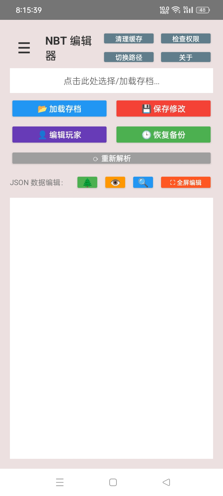
   
  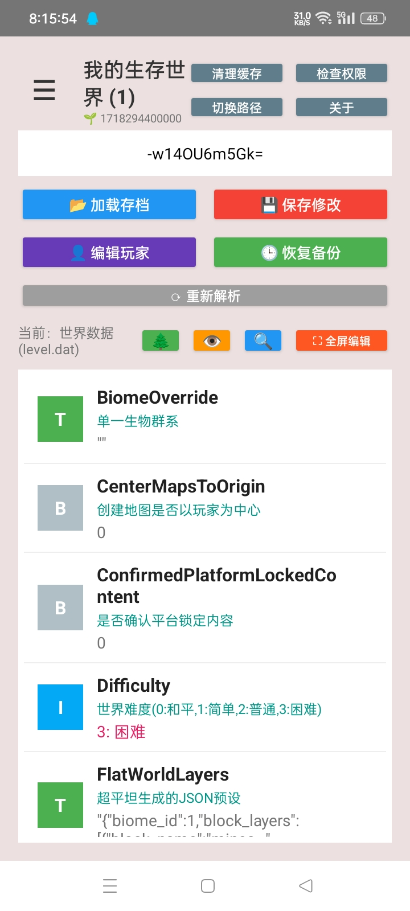
   
  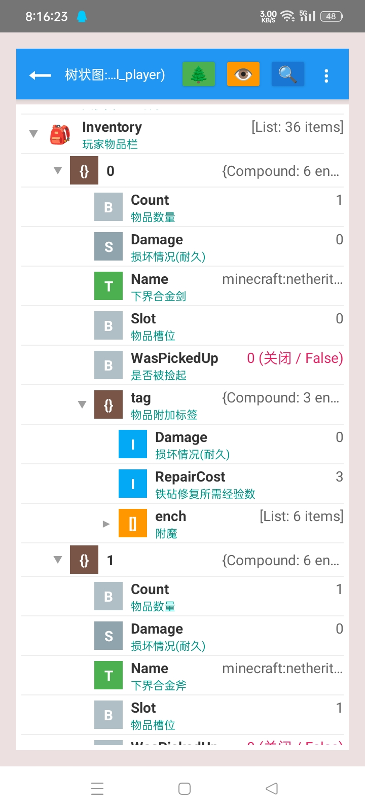
   
  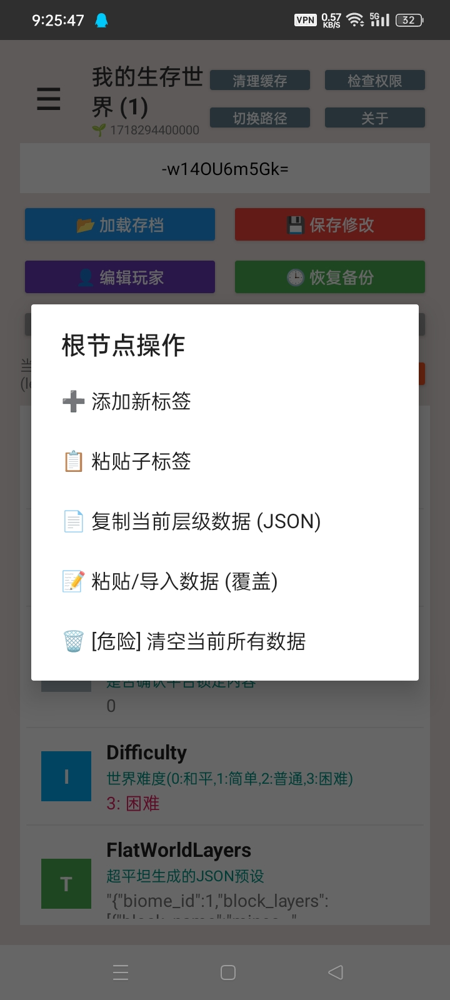
   
  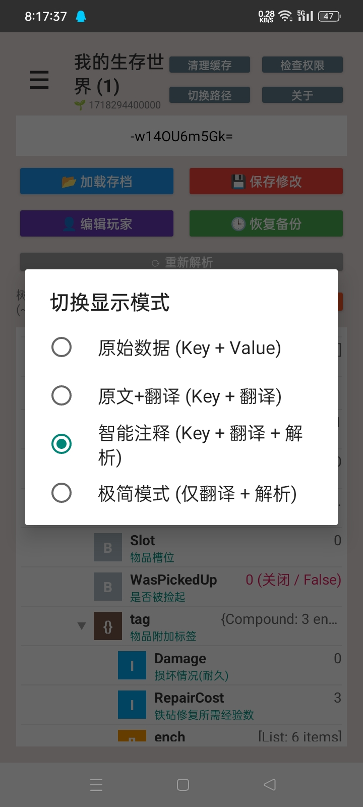
   
  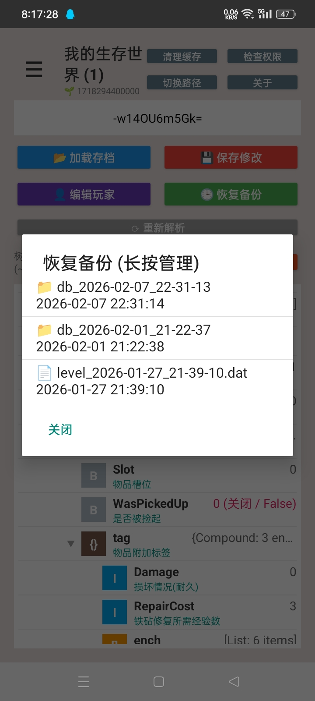
   
  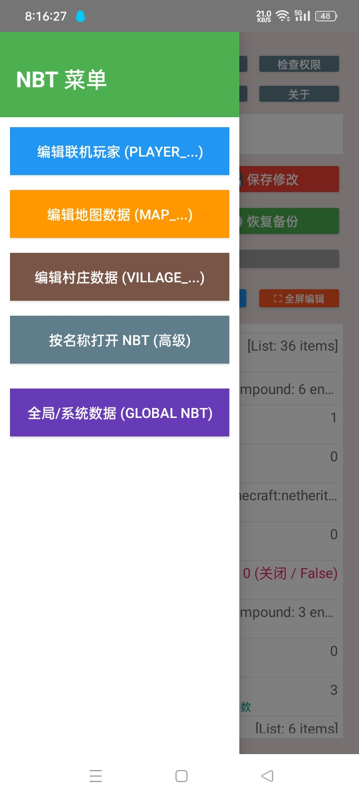
   
  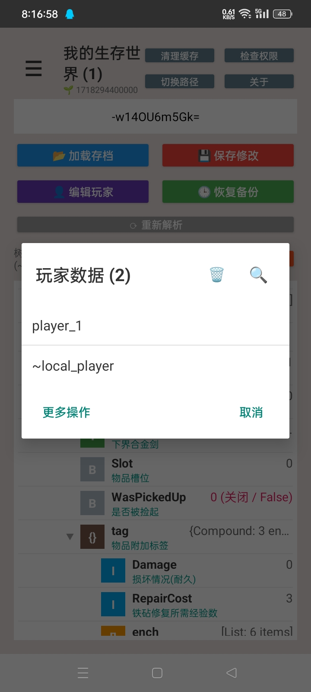
   
  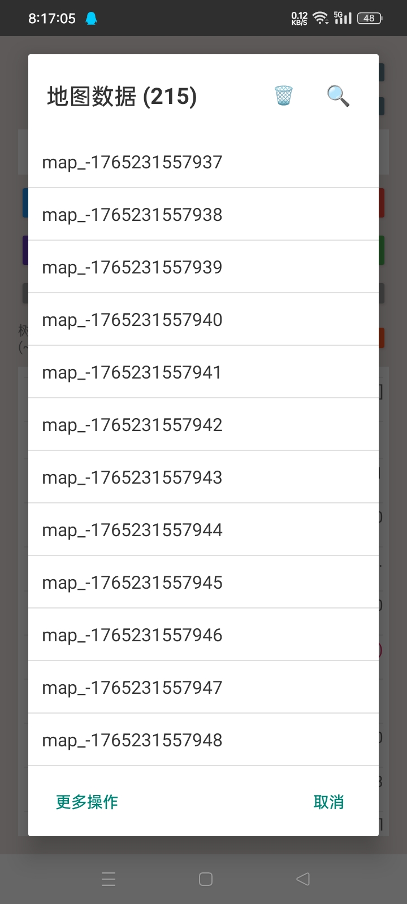
   
  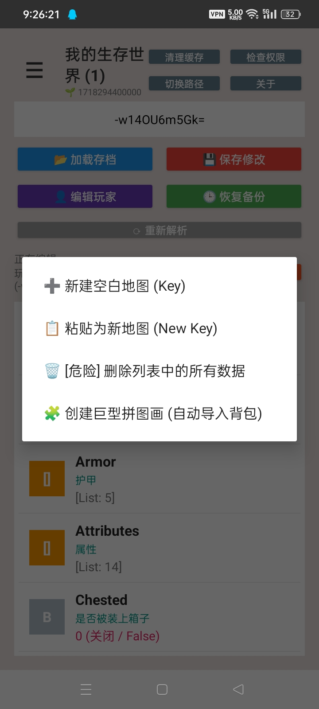
   
  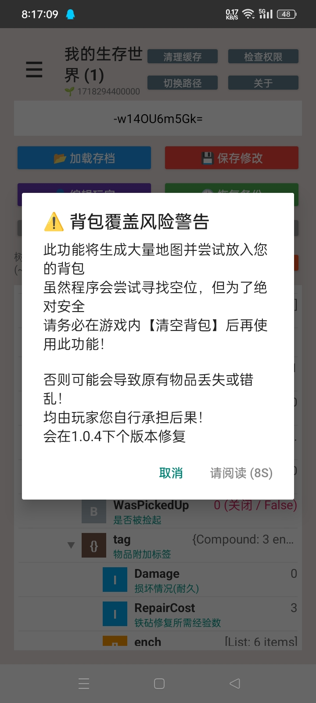
   
  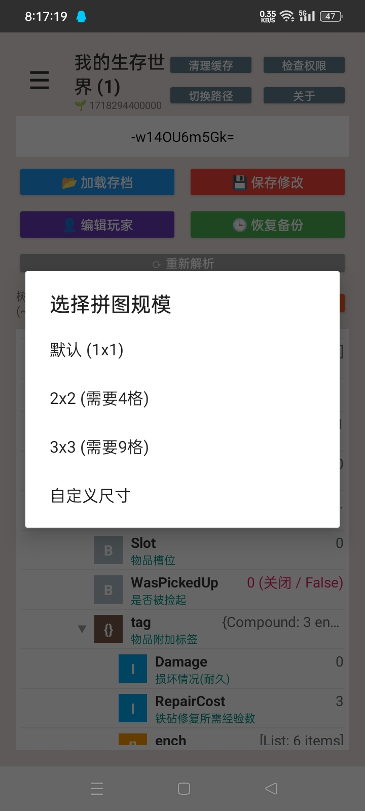
   
  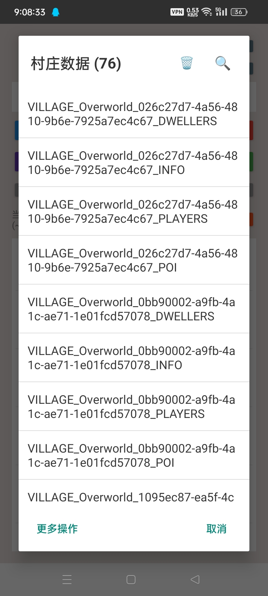
   
  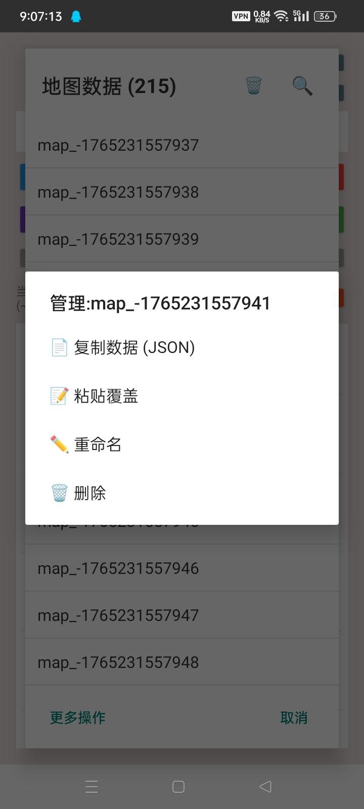
   
  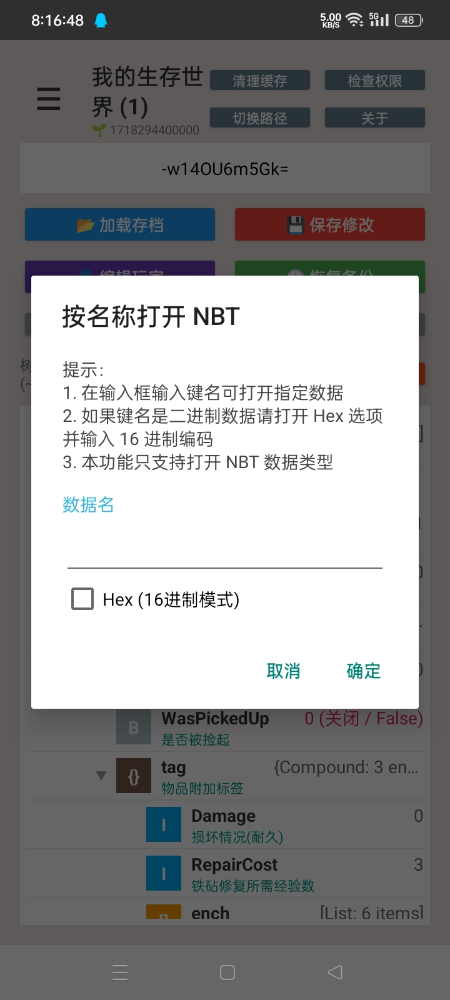
   
  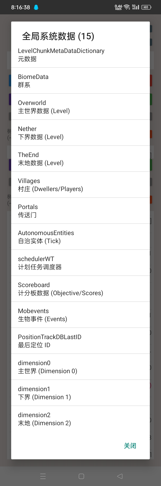
   

## 🚀 快速上手
### 📺 使用介绍

介绍与使用教程：

> [!TIP]
> 确保您**具有基础[Shizuku](https://github.com/RikkaApps/Shizuku)使用**，此应用会在启动时索要 
> 否则会**无法访问Android/data** Minecraft 文件 
> **目前支持Android 6 ~ 13** 
> 获取所有文件权限是为了，下载目录与旧目录读写和私有目录往返

## 📄 更新日志

<kbd>已解决</kbd>

- [x] 回收站：删除存档先移入回收站，不再直接抹掉
- [x] 导出 `.mcworld`：把整个世界打包成可被 Minecraft 直接导入的存档包
- [x] 草稿箱：未保存的编辑收进草稿箱，不再用弹窗打扰
- [x] 剪贴板重做：复制同时写入系统剪贴板，支持 JSON / SNBT / 纯文本
- [x] 导出到文件：可存下载目录，也可走 SAF 自选任意目录
- [x] **SAF 完整实现**：读写删全部走 DocumentFile，保存不再「谎报成功」
- [x] 选择世界 / 草稿箱 / 备份三个列表统一格式，底部标签栏 + 长按菜单
- [x] **修复：玩家数据新增 List 后保存丢失** —— 真根因是误删 LevelDB 索引文件
- [x] 修复：大存档被误判为 LOCK 导致打不开
- [x] 修复：树形视图全面可用（增 / 改 / 删 / 搜索 / 保存）
- [x] 修复：地图画生成内存溢出
- [x] 修复：备份目录两套定义不一致（「清空备份」清的是空目录却提示成功）
- [x] 修复：一展开设置就弹「自定义」输入框、设置面板无法滚动
- [x] 修复：设置自定义草稿间隔 / 线程数时崩溃
- [x] 修复：会话恢复对话框张冠李戴、「丢弃后会话又复活」
- [x] 修复：标签栏不贴底
- [x] 修复：issue #6 —— 自定义路径保存不再误报「需要 Shizuku」
- [x] 多线程设置真正生效（文件复制 + 地图画，并发数可调）
- [x] 国际化补齐（中英字符串严格对称）
- [x] 按功能域重新分包（`nbt/` `db/` `editor/` `world/` `mapart/` `util/`）
- [x] 改名为 樱喵NBT / Nibnya，更换图标，数据目录 `NbtEditor_Data/` → `Nibnya/`

<kbd>待解决</kbd>

- [ ] 运行内存不足（大存档会被系统杀进程）
- [ ] 自动更新
- [ ] 手动优化 UI
- [ ] 备份逻辑优化（不再每次保存都备份；改为按时间 / 用户勾选 / 手动）
- [ ] 地图平面展示与编辑（区块查看 / 修改 / 移动）
- [ ] 存档多开（同一存档不可多窗打开）
- [ ] Blocktopograph 风格界面
- [ ] 预设模板（玩家 / 村庄 / 地图）
- [ ] 一键修改工具（装备 32767、命令行物品等）
- [ ] Minecraft 实用基岩版工具页（第三页面）
- [ ] 老地图升级（跨大版本 NBT 升级）
- [ ] 多用户兼容
- [ ] KMP 跨平台（Windows / Linux 桌面版）

_其他想法和修改还在实现中_

## 👥 感谢列表
 [@Yejdhi](https://github.com/Yejdhi) 给我提供了许多方法和修改的点子 
 [@LeviMC](https://github.com/LiteLDev) 给我提供了方法和修改的点子 
(也推荐看看LeviMC他们的开源项目)

## 📜 开源协议

本项目采用 **[AGPL 3.0](https://www.gnu.org/licenses/agpl-3.0)** 协议

<!-- 这里是底部的链接定义-->

[version-shield]: https://img.shields.io/badge/版本-v1.0.4a-369eff?style=flat-square&labelColor=black
[version-link]: https://github.com/yinghuajimew/Nibnya/releases

[issues-shield]: https://img.shields.io/github/issues/yinghuajimew/Nibnya?color=ff80eb&labelColor=black&style=flat-square
[issues-link]: https://github.com/yinghuajimew/Nibnya/issues

[forks-shield]: https://img.shields.io/github/forks/yinghuajimew/Nibnya?color=8ae8ff&labelColor=black&style=flat-square
[forks-link]: https://github.com/yinghuajimew/Nibnya/network/members

[stars-shield]: https://img.shields.io/github/stars/yinghuajimew/Nibnya?color=ffcb47&labelColor=black&style=flat-square
[stars-link]: https://github.com/yinghuajimew/Nibnya/stargazers

[contributors-shield]: https://img.shields.io/github/contributors/yinghuajimew/Nibnya?color=c4f042&labelColor=black&style=flat-square
[contributors-link]: https://github.com/yinghuajimew/Nibnya/graphs/contributors

[license-shield]: https://img.shields.io/badge/license-AGPL_3.0-blue?style=flat-square&labelColor=black
[license-link]: https://www.gnu.org/licenses/agpl-3.0

<!-- 社交链接定义 -->

<!-- Bilibili: 少女粉 #FB7299 -->
[bilibili-shield]: https://img.shields.io/badge/Bilibili-FB7299?style=flat-square&labelColor=black&logo=bilibili&logoColor=white
[bilibili-link]: https://www.bilibili.com/video/BV1mkfnBnEKC

<!-- QQ交流群: 腾讯蓝 #12B7F5 -->
[qq-shield]: https://img.shields.io/badge/QQ交流群-12B7F5?style=flat-square&labelColor=black&logo=qq&logoColor=white
[qq-link]: https://qm.qq.com/cgi-bin/qm/qr?_wv=1027&group_code=1077349003

<!-- Telegram频道: 电报蓝 #26A5E4 -->
[tg-shield]: https://img.shields.io/badge/Telegram频道-26A5E4?style=flat-square&labelColor=black&logo=telegram&logoColor=white
[tg-link]: https://t.me/yhjmew_minecraft_nbteditor